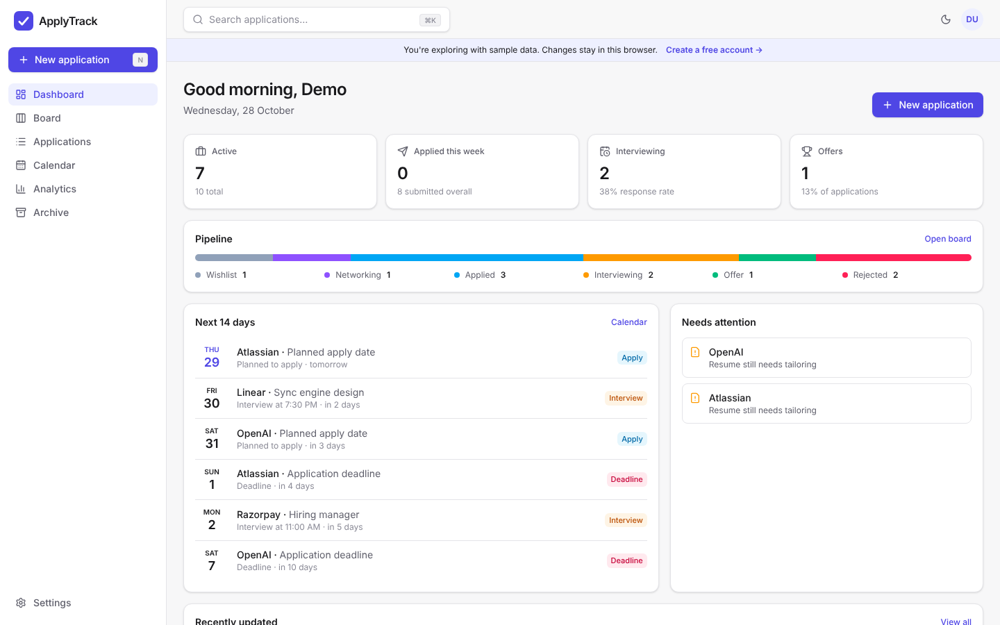
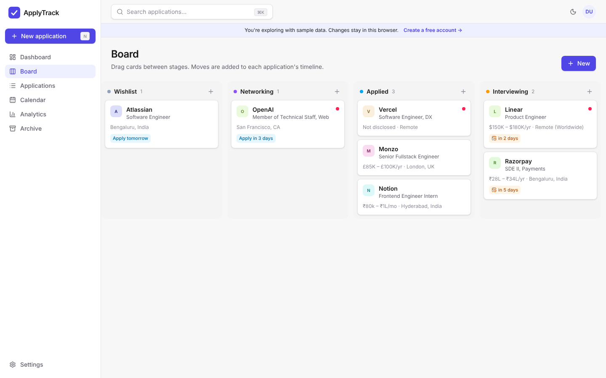
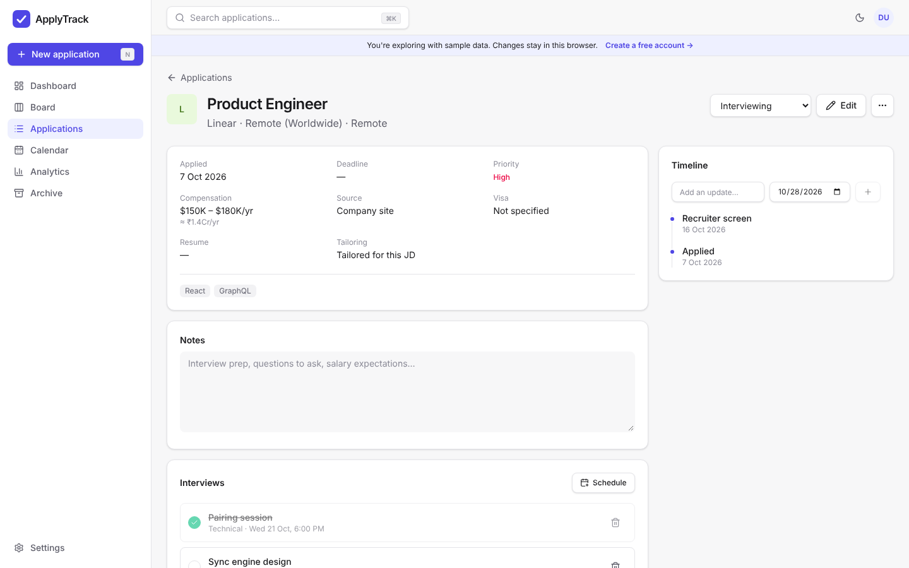
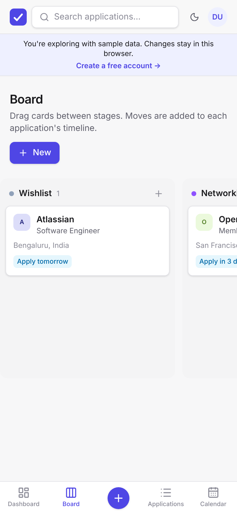
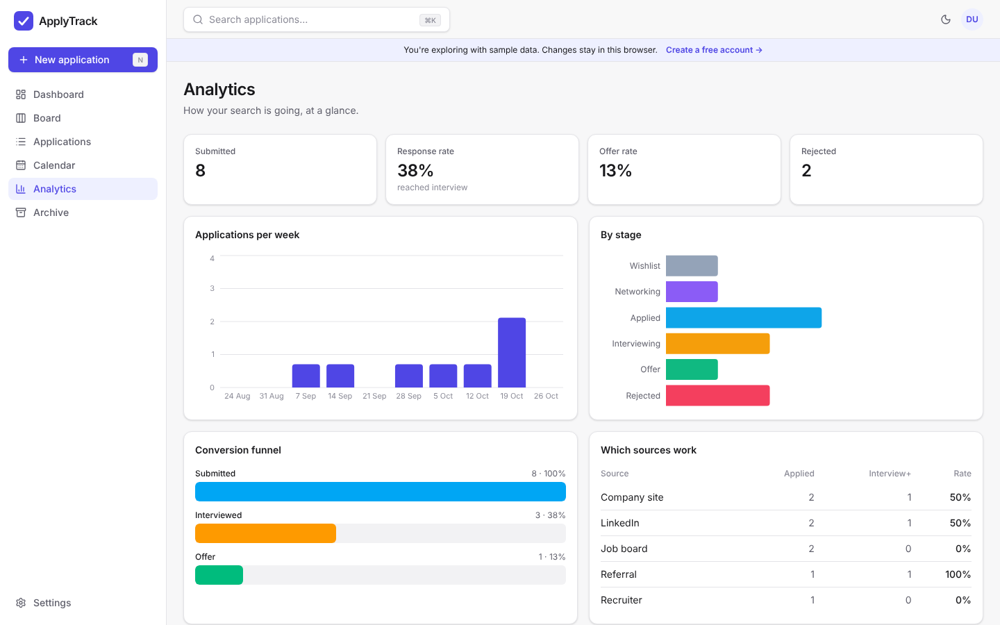
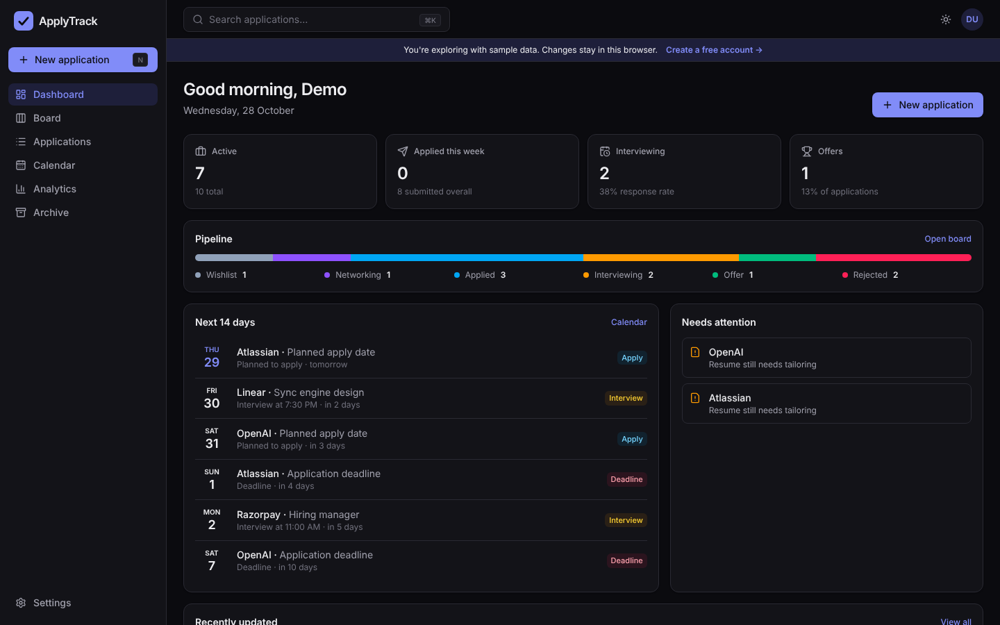

# ApplyTrack — Job Application Tracker

[](https://github.com/anshuln26/Job-Application-Tracker/actions/workflows/ci.yml)
[](https://job-application-tracker-alpha-seven.vercel.app)
[](LICENSE)

Track every job application, interview, referral and offer in one fast, private workspace.

**[Live app →](https://job-application-tracker-alpha-seven.vercel.app)** — click **Try the demo** to explore with sample data, no signup needed.



## Features

- **Kanban pipeline:** drag applications between six stages (Wishlist → Networking → Applied → Interviewing → Offer / Rejected). Works with mouse, touch and keyboard, uses optimistic updates, and logs every move to the application's timeline.
- **Dashboard:** active pipeline, weekly progress, response rate, the next 14 days of interviews and deadlines, and reminders for applications that need a follow-up or a tailored resume.
- **Application detail page:** interviews (with done/undone), a timeline of updates, inline notes, referral and recruiter contact info, and compensation converted to your display currency.
- **Searchable table:** full-text search, stage and work-type filters, sortable columns, bulk move / archive / delete, and filters saved in the URL.
- **Calendar:** month view of interviews, deadlines and planned apply dates, plus **.ics export** to Google Calendar, Outlook or Apple Calendar.
- **Analytics:** weekly applications, stage breakdown, conversion funnel, which sources lead to interviews, and an offer comparison across currencies.
- **Pay in any format:** yearly CTC, monthly stipend or hourly rate in 11 currencies, with INR shown in lakh/crore (₹12.5L, ₹1.2Cr).
- **Import / export:** CSV (spreadsheet-safe) and full JSON backups.
- **Keyboard-first:** `⌘K` / `Ctrl+K` command palette, `N` to add an application.
- **Accounts:** email + password with email confirmation, Google sign-in, password reset, and self-service account deletion.
- **Demo mode:** a sandbox stored in the browser, so recruiters can try the app without creating an account.
- **Responsive and themed:** mobile bottom navigation, light/dark/system theme, and accessible dialogs (focus trap, Escape to close, ARIA roles).

| Board | Detail | Mobile |
| --- | --- | --- |
|  |  |  |

| Analytics | Dark mode |
| --- | --- |
|  |  |

## Tech stack

| Layer | Choice |
| --- | --- |
| UI | React 19, TypeScript (strict), Tailwind CSS v4 |
| Routing / data | React Router 7, TanStack Query 5 (caching, optimistic mutations) |
| Drag & drop | dnd-kit |
| Charts | Recharts |
| Backend | Supabase: Postgres, Auth, Row Level Security |
| Tooling | Vite 8, Vitest + Testing Library, oxlint, GitHub Actions CI |
| Hosting | Vercel |

## Architecture

```
src/
├── auth/AuthProvider.tsx      Session state, demo mode, picks the storage backend
├── data/
│   ├── repository.ts          Repository interface → Supabase or localStorage (demo)
│   ├── mappers.ts             DB rows ⇄ domain objects, legacy data normalization
│   └── demo.ts                Sample data with dates relative to today
├── hooks/useApplications.ts   TanStack Query hooks with optimistic updates
├── lib/                       Pure logic: stats, currency, CSV, dates (unit-tested)
├── components/                UI primitives, app shell, command palette, forms
└── pages/                     Route-level screens (lazy-loaded)
```

- **One interface, two backends.** Screens talk to a `Repository`. Signed-in users get the Supabase implementation, and demo users get a `localStorage` one, so the demo runs exactly the same code as the real app.
- **Security is enforced in the database.** RLS policies (`auth.uid() = user_id`) mean even a modified client can't read or change anyone else's rows. Auth flows use Supabase's built-in email confirmation and recovery. No secrets live in the client.
- **Code-splitting.** Each page is lazy-loaded, so the initial bundle is about 110 KB gzipped and the charts library loads only on the Analytics page.

## Run it locally

```bash
git clone https://github.com/anshuln26/Job-Application-Tracker.git
cd Job-Application-Tracker
npm install
npm run dev
```

The app runs in demo-only mode without any configuration. To enable accounts:

1. Create a free project at [supabase.com](https://supabase.com).
2. In the SQL editor, run [`supabase/schema.sql`](supabase/schema.sql).
3. Copy `.env.example` to `.env.local` and fill in your project URL and anon key.
4. In **Authentication → URL Configuration**, add `http://localhost:5173/**` (and your production URL) to the redirect URLs.
5. Optional: enable **Google** under **Authentication → Providers**.

```bash
npm test          # unit tests
npm run typecheck # TypeScript
npm run lint      # oxlint
npm run build     # production build
```

## License

[MIT](LICENSE)
