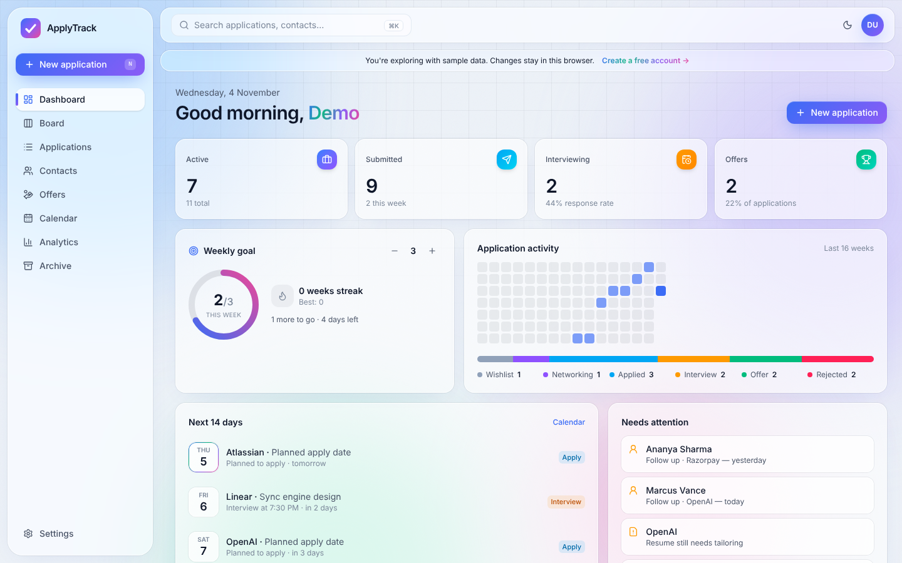
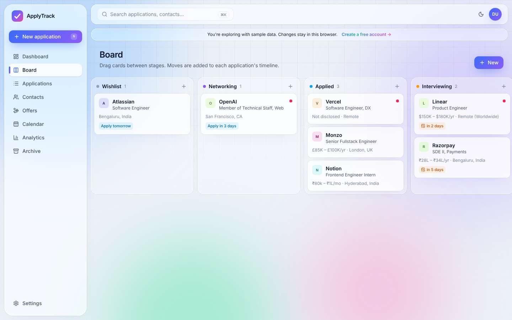
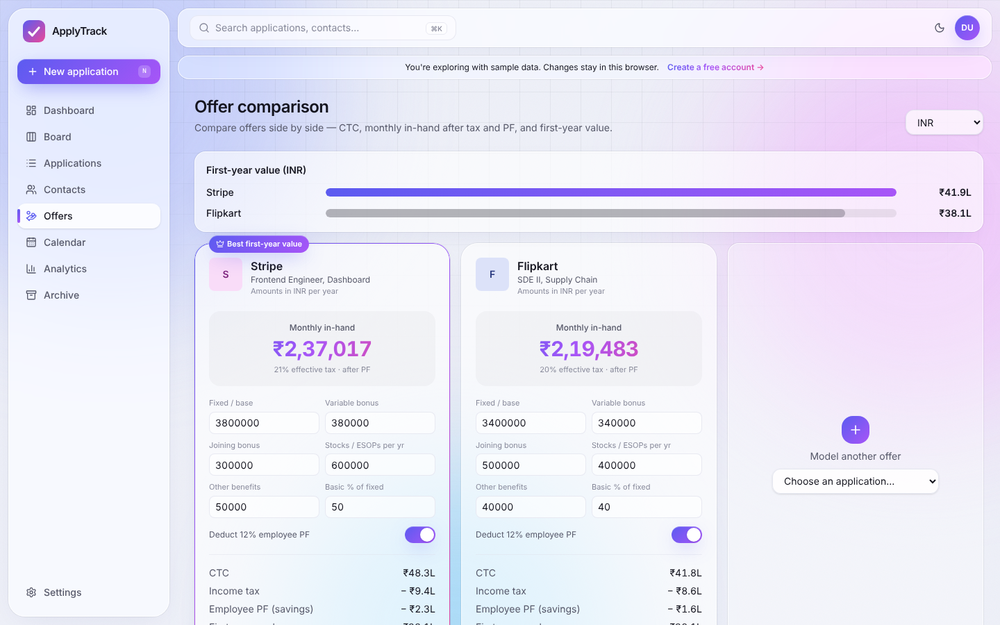
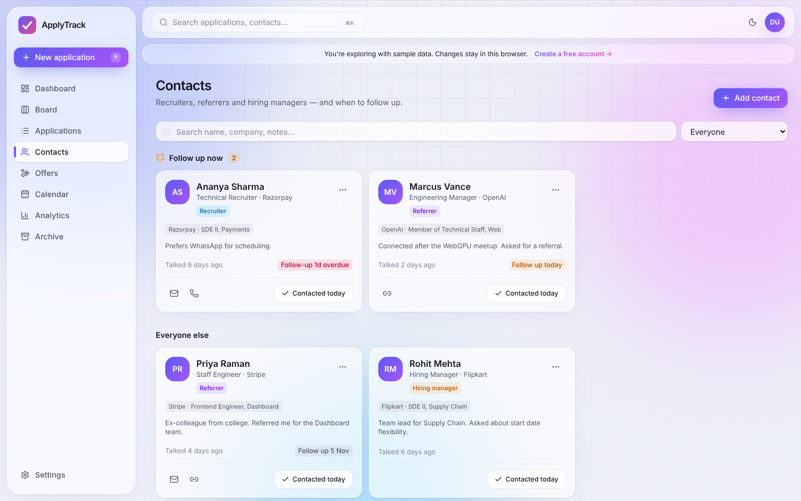
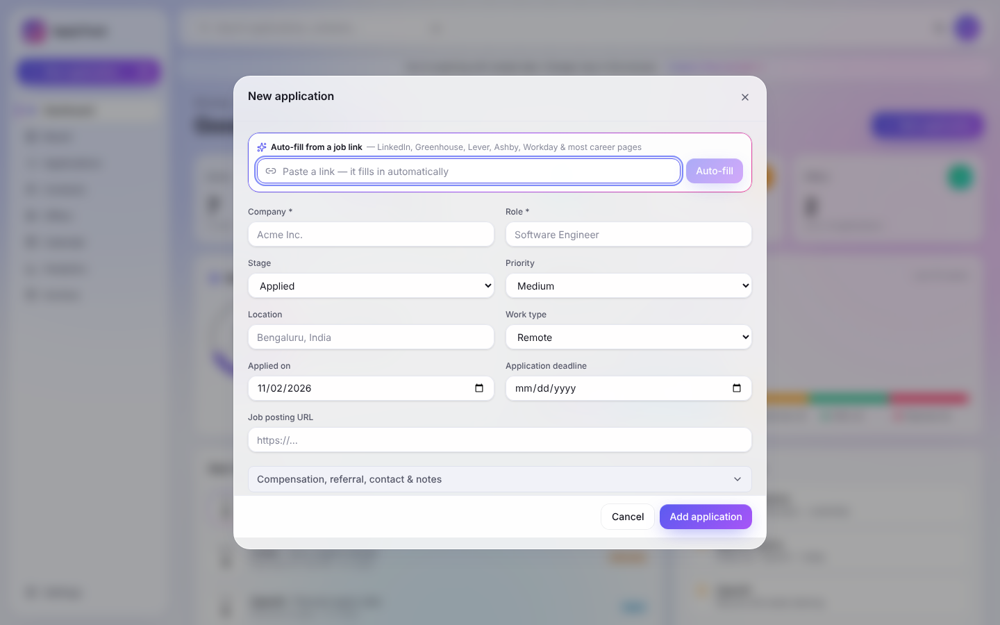
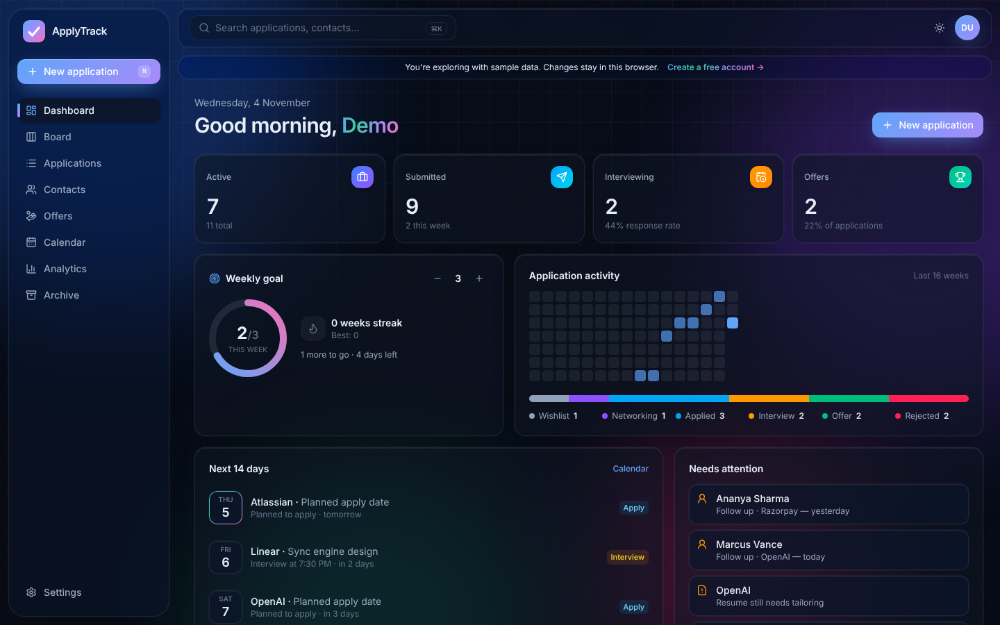
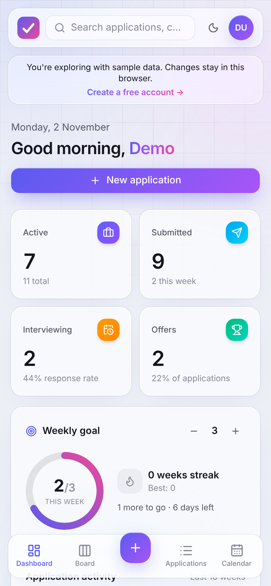

# ApplyTrack — Job Application Tracker

[](https://github.com/anshuln26/Job-Application-Tracker/actions/workflows/ci.yml)
[](https://job-application-tracker-alpha-seven.vercel.app)
[](LICENSE)

Track every job application, interview, referral and offer in one fast, private workspace — with reminders, calendar sync, offer math and two-step verification built in.

**[Live app →](https://job-application-tracker-alpha-seven.vercel.app)** — click **Try the demo** to explore with sample data, no signup needed. Installable on phone and desktop.



## Features

**Tracking**
- **Paste a link, get an application:** auto-fills company, role, location, pay and deadline from LinkedIn, Greenhouse, Lever, Ashby and any careers page that publishes schema.org `JobPosting` data.
- **Drag-and-drop board** across six stages, with optimistic updates, keyboard support, every move logged to the timeline, and confetti when an offer lands.
- **Searchable table** with filters, sorting, bulk actions and CSV/JSON import and export.
- **Application page** with interviews, timeline, notes, referral details and linked contacts.

**Staying on top of things**
- **Dashboard** with live counters, the next 14 days, a "needs attention" list, a **weekly goal with streaks**, and a 16-week activity heatmap.
- **Reminders:** a daily email digest and **phone/desktop push notifications** for interviews, deadlines, planned applications and follow-ups (Vercel Cron, daily).
- **Calendar sync:** a private iCal feed that you subscribe to once in Google Calendar, Outlook or Apple Calendar. A month view and `.ics` export are built in too.
- **Contacts:** recruiters, referrers and hiring managers linked to applications, with follow-up dates and one-click "contacted today".

**Decisions**
- **Offer comparison:** monthly in-hand pay after Indian new-regime tax (Budget 2025 slabs, 87A rebate with marginal relief, surcharge, cess), PF and professional tax. Also first-year cash and total value, side by side in any of 11 currencies.
- **Analytics:** weekly volume, stage breakdown, conversion funnel and which sources lead to interviews.

**Platform**
- **Installable PWA:** works offline, has an app icon, and shortcuts.
- **Two-step verification** with an authenticator app (TOTP) or an emailed code. It is **enforced in Postgres** by restrictive row-level-security policies, not just in the UI.
- Email/password, Google sign-in, password reset and self-service account deletion.
- **Demo mode** that runs entirely in the browser.
- Frosted-glass UI with light and dark themes, motion that respects `prefers-reduced-motion`, ⌘K command palette and `N` to add.

| Board | Offers | Contacts |
| --- | --- | --- |
|  |  |  |

| Auto-fill from a link | Dark mode | Mobile |
| --- | --- | --- |
|  |  |  |

## Tech stack

| Layer | Choice |
| --- | --- |
| UI | React 19, TypeScript (strict), Tailwind CSS v4 |
| Data | TanStack Query 5 (cache + optimistic mutations), React Router 7 |
| Backend | Supabase: Postgres with row-level security, Auth (TOTP MFA), RPC functions |
| Server | Vercel Functions (`/api`): job-link parser, iCal feed, push and email, daily cron |
| Interactions | dnd-kit, Recharts, Web Push (VAPID), service worker |
| Quality | Vitest (39 tests), oxlint, GitHub Actions CI |

## Architecture

```
api/                         Vercel Functions (Node)
├── parse-job.ts             URL → job fields (ATS APIs, JSON-LD, SSRF-guarded fetch)
├── calendar.ts              private iCal feed (token → RPC → .ics)
├── cron/reminders.ts        daily digest: email + web push
├── 2fa/email-code.ts        emails a one-time code
├── push-test.ts, status.ts
└── _lib/                    pure, unit-tested helpers (parser, digest, ics, notify)

src/
├── auth/AuthProvider.tsx    session, second-factor status, demo mode, storage backends
├── data/                    repositories: Supabase or localStorage (demo) behind one interface
├── hooks/                   TanStack Query hooks with optimistic updates
├── lib/                     stats, goals, tax, currency, CSV, PWA helpers (unit-tested)
├── components/              glass UI kit, app shell, forms, 2FA flows
└── pages/                   route-level screens (lazy-loaded)

supabase/
├── schema.sql               base schema for a fresh project
└── migrations/              incremental changes (apply in order)
```

**Security model**
- Every table has owner-only RLS (`auth.uid() = user_id`).
- Users who turn on 2FA get an extra *restrictive* policy. It requires either an `aal2` session (authenticator app) or a session that passed an email code. A stolen password alone can't read their data.
- Server functions talk to the database with the public anon key plus either a hashed shared secret or a capability token. The Supabase service-role key is never used.
- The job-link fetcher blocks private and link-local addresses, re-checks every redirect, and caps response size and time.

## Run it locally

```bash
git clone https://github.com/anshuln26/Job-Application-Tracker.git
cd Job-Application-Tracker
npm install
npm run dev
```

The app runs in demo mode without any configuration. To enable accounts:

1. Create a free project at [supabase.com](https://supabase.com).
2. In the SQL editor, run [`supabase/schema.sql`](supabase/schema.sql), then every file in [`supabase/migrations/`](supabase/migrations) in order.
3. Copy `.env.example` to `.env.local` and fill in `VITE_SUPABASE_URL` and `VITE_SUPABASE_ANON_KEY`.
4. In **Authentication → URL Configuration**, add `http://localhost:5173/**` and your production URL to the redirect URLs.
5. Optional: enable **Google** under **Authentication → Providers**.

### Server features (reminders, push, email codes)

These run as Vercel Functions. Use `vercel dev` to try them locally.

1. Run `npm run setup:secrets`. It prints a `CRON_SECRET`, VAPID keys and one SQL line. Add the values to Vercel → Settings → Environment Variables, and run the SQL in Supabase.
2. Add an email sender. Any SMTP works; with Gmail, turn on 2-Step Verification and create an [app password](https://myaccount.google.com/apppasswords), then set:
   `SMTP_HOST=smtp.gmail.com`, `SMTP_PORT=465`, `SMTP_USER`, `SMTP_PASS` (the app password) and `EMAIL_FROM`.
3. Recommended: use the same SMTP details under Supabase → Authentication → **SMTP Settings**. Supabase's built-in email service only delivers to your own team's addresses, so other users won't get confirmation or reset emails without this.
4. Redeploy.

```bash
npm test           # unit tests
npm run typecheck  # TypeScript (app + functions)
npm run lint       # oxlint
npm run build      # production build
```

## License

[MIT](LICENSE)
